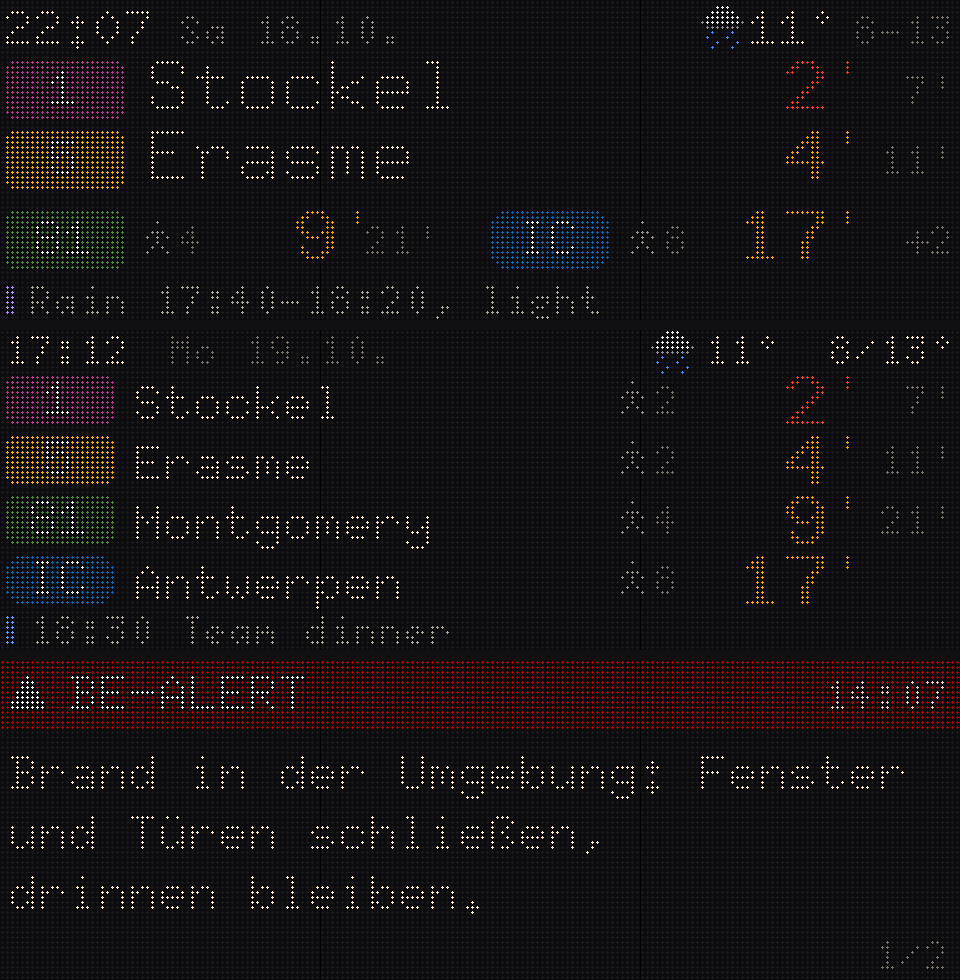

# Perron

**A real-time departure board for Brussels on a 192×64 RGB LED matrix.**
Tram, bus and metro (STIB/MIVB), trains (SNCB/NMBS), weather (RMI/KMI), BE-Alert and your own
information — in the visual language of the operators, running entirely on its own.

> *Perron* is French and Dutch for "platform".

## Highlights

- **Standalone.** The ESP32-S3 fetches everything itself — no server, no Home Assistant required.
  Home Assistant is an optional extra, not a dependency.
- **Departures that answer "should I leave now?"** Large minute digits, coloured by your walking
  time per stop: amber = catchable, red = leave now. Imminent arrivals show the STIB ↓↓ signal.
- **Operator look.** Official STIB/SNCB line colours from GTFS, rounded STIB badges and SNCB
  plaques; light line colours are drawn as outlines so they stay legible on LEDs.
- **Fixed rows.** Every line and direction keeps its place; when nothing runs soon the next
  departure time is shown instead of an empty row.
- **Weather & alerts.** RMI/KMI current conditions, min/max and pictograms, a 10-minute radar
  rain nowcast, RMI warnings, STIB disruptions for your lines and BE-Alert messages for your
  location (full-screen takeover).
- **Consumer-grade setup.** Wi-Fi hotspot with QR code, an on-device setup wizard and a
  phone-GPS helper that suggests the nearest stops, lines and directions.
- **Thoughtful details.** Three layouts, night mode, automatic brightness (ambient light sensor),
  automatic over-the-air updates at night, write-only API key storage.

## Hardware

| Part | Notes |
|---|---|
| 3 × 64×64 P4 HUB75 panels | 768 × 256 mm, chained horizontally |
| Adafruit MatrixPortal S3 | ESP32-S3 with 2 MB PSRAM |
| 5 V / 30 A power supply | with inline fuse, star wiring to each panel |
| VEML7700 light sensor | optional, plug-and-play via STEMMA QT |

Full parts list: [`hardware/bom.csv`](hardware/bom.csv) · wiring and assembly: [docs/hardware.md](docs/hardware.md)

## Getting started

1. **Flash** the firmware once over USB (`esphome run esphome/perron.yaml`).
2. **Join Wi-Fi:** the board shows a QR code — scan it, pick your network.
3. **Set up:** scan the second QR code (or open the board's address) and follow the wizard:
   stops and lines (with phone GPS), train station, data sources, appearance.
4. **Optional:** add your free STIB API key from the Belgian Mobility open-data portal for a
   generous rate limit.
5. Done. Updates arrive automatically at night.

Details: [docs/setup.md](docs/setup.md)

## Home Assistant

The board is discovered by the ESPHome integration. All settings appear as entities, departures
are published as sensors, and the `push_card` action shows calendar events, car commute times or
any text from Home Assistant. A ready-made blueprint is included.
See [docs/home-assistant.md](docs/home-assistant.md).

## Repository

| Path | Contents |
|---|---|
| `esphome/` | Firmware (ESPHome configuration, C++ data layer and renderer, setup UI, fonts) |
| `site/` | GPS setup helper and stop/station data (served via GitHub Pages) |
| `blueprints/` | Home Assistant automation blueprint |
| `tools/` | Pixel-exact mockup renderer and asset generators |
| `hardware/` | Bill of materials |
| `custom_components/diele_board/` | Legacy Home Assistant integration (deprecated, see docs) |

Development notes: [docs/development.md](docs/development.md) · Data sources and licences:
[docs/data-sources.md](docs/data-sources.md)

## Licence

Source code: MIT (see [LICENSE](LICENSE)). Built firmware images contain ESPHome, whose C++ runtime
is GPL-3.0; firmware binaries are therefore distributed under GPL-3.0 with this source.
Bitmap fonts: X11 misc-fixed (public domain). Transit and weather data belong to their providers.

---

Deutsch: [README.de.md](README.de.md)
