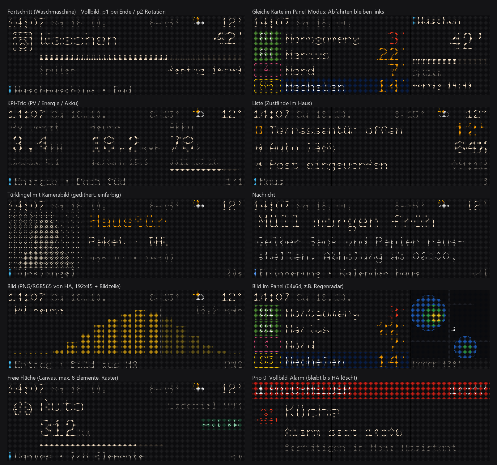

# Cards from Home Assistant

Departures come first; cards are guests. A card either takes the full screen for a short time
(status bar stays), or panel 3 (x128–191) while the departures move to the left two panels, or
one line in the pager.



## Sending a card

```yaml
action: esphome.perron_push_json
data:
  card: >-
    {"id":"washer","t":"prog","p":2,"ic":"washer","ti":"Waschen","val":"42'","pct":63,
     "sub":"Spülen|fertig 14:49","ttl":5400}
```

The same `id` replaces the card. `{"id":"washer","del":1}` removes it. The diagnostic sensor
**Kartenstatus** shows the result of the last call, for example `Karte washer (prog) ok` or the
reason a card was rejected. The **Karten-Demo** button cycles through example cards.

### Common keys

| Key | Meaning |
|---|---|
| `id` | card identity (max 32 characters) |
| `t` | template: `hero` `prog` `list` `msg` `kpi` `ring` `img` `cv` |
| `p` | priority: `0` alarm, `1` event, `2` state (default), `3` ambient |
| `z` | zone: `f` full screen, `p` panel, `l` pager, `a` automatic (default) |
| `s` | severity: `i` info, `a` attention (amber), `x` alarm (red title + rule) |
| `tag` | topic colour: `cal` `com` `wx` `dis` `alr` `news` `ha` (default) |
| `ttl` | seconds until the card disappears (0 = until removed) |
| `hold` | seconds on the full screen for a `p:1` event (3–30, default 15) |
| `ic` `ti` `val` `u` `sub` `ft` `pct` | icon, title, value, unit, secondary text, footer, percent |

`sub` takes two parts separated by `|` (left/right or first/second line).

### Where a card appears

- `p:0` – full-screen alarm (red band), stays until removed or `ttl` expires.
- `p:1` – full screen for `hold` seconds after every content change, then panel until `ttl`.
  At night only `ring` cards go full screen.
- `p:2` – panel; several panel cards alternate every 10 s. With `z:"f"`: 8 s every 45 s on the full screen.
- `p:3` – one line in the pager.
- While a departure shows red minutes (leave now), no card takes the full screen.

### Templates

| `t` | Use | Fields |
|---|---|---|
| `hero` | one big value (travel time, temperature) | `ic` `val` `u` `ti` `sub` |
| `prog` | progress (washer, charging) | `ic` `ti` `val` `pct` `sub` |
| `list` | 2–4 rows | `rows: [[icon, label, value, colour], …]` |
| `msg` | text message, paged | `ti` `sub` (up to 200 characters) |
| `kpi` | 2–3 numbers side by side | `kpi: [[label, value, unit, colour, pct, sub], …]` |
| `ring` | doorbell / visitor | `ic` `ti` `sub` `img` |
| `img` | image | `img` (slot name), `ti`, `ft`, `fb:1` = full bleed 192×64 (max 10 s) |
| `cv` | free canvas | `el` (see below) |

Colours are tokens, never hex: `w` warm white, `s` grey, `a` amber, `r` red, `rc` red chip,
`nv` SNCB navy, `w:2` / `w:4` dimmed, or a `tag` name.
Fonts: `tiny` `small` `mid` `dest` `big` `clock`.
Icons: 16 px `bell` `person` `washer` `car` `battery` `smoke` and the weather conditions;
7 px `bell` `washer` `car` `battery` `door` `sun` `plug` `info` `walk` `warn`.

### Canvas (`t:"cv"`)

Up to 8 elements on a 2 px grid, inside the safe area (full screen x1–190, y11–55; panel
x130–190, y0–63). One `clock` number per 64 px panel, at most one image. A card that breaks a
rule is rejected as a whole (see **Kartenstatus**).

```json
{"id":"car","t":"cv","p":2,"z":"f","el":[
  ["i",4,14,"car",16,"w"], ["t",26,14,"Auto","dest","w"], ["n",26,30,"312","clock","w"],
  ["t",58,38,"km","small","s"], ["g",26,50,100,2,78,"w"], ["b",146,30,"+11 kW","nv"]]}
```

Elements: `["t",x,y,text,font,col]` text, `["n",…]` number, `["i",x,y,icon,size,col]`,
`["b",x,y,text,col]` chip, `["r",x,y,w,h,col,fill]`, `["g",x,y,w,h,pct,col]` bar,
`["m",x,y,slot]` image.

## Images

Images go into named slots (up to 3) and are referenced by cards (`"img":"door"`). Bright
images are dimmed to an average of 35 % so they stay calm on the LEDs.

**PNG, JPEG or BMP by URL** – the board downloads it (max 192×64 after scaling):

```yaml
action: esphome.perron_push_image_url
data:
  key: door
  url: "http://<ha-ip>:8123{{ state_attr('camera.front_door', 'entity_picture') }}&width=192"
```

`entity_picture` contains a short-lived access token, so no long-lived token is stored on the
board. Camera snapshots (`camera_proxy`, `.jpg`) are decoded as JPEG – append `&width=192` so
Home Assistant scales the picture first; `.bmp` is decoded as BMP, everything else as PNG.

**Raw RGB565 pixels over the API** – no URL needed; base64, little endian, sent in parts of at
most 8 KB raw data (192×64 = 3 parts):

```yaml
action: esphome.perron_push_image
data: {key: chart, seq: 0, total: 3, width: 192, height: 64, data: "<base64>"}
```

`tools/rgb565_chunks.py` converts any image into these parts.
